# Manual de usuario — Monte ERP

Monte ERP es una aplicación de escritorio para gestionar el catálogo, las compras,
las ventas y el stock de una tienda de informática. Este manual recorre la
aplicación de principio a fin con capturas reales de la ventana.

> **Las capturas de este manual las genera la propia aplicación.** Se obtienen
> recorriendo la interfaz con los tests de TestFX (`ManualCaptureUiTest`), así que
> siempre muestran pantallas reales y nunca un mockup. En el
> [manual de despliegue](../manual_de_despliege/manual.md) se explica cómo
> regenerarlas.

## Índice

1. [Roles y permisos](#1-roles-y-permisos)
2. [Puesta en marcha](#2-puesta-en-marcha)
3. [Iniciar y cerrar sesión](#3-iniciar-y-cerrar-sesión)
4. [Configuración de la base de datos](#4-configuración-de-la-base-de-datos)
5. [Ventana principal y navegación](#5-ventana-principal-y-navegación)
6. [Gestión de usuarios (solo administrador)](#6-gestión-de-usuarios-solo-administrador)
7. [Categorías](#7-categorías)
8. [Proveedores y clientes](#8-proveedores-y-clientes)
9. [Productos](#9-productos)
10. [Compras y entrada de stock](#10-compras-y-entrada-de-stock)
11. [Pedidos de venta y consumo FIFO](#11-pedidos-de-venta-y-consumo-fifo)
12. [Control de stock](#12-control-de-stock)
13. [Informes y exportación](#13-informes-y-exportación)
14. [Mensajes habituales](#14-mensajes-habituales)

---

## 1. Roles y permisos

La aplicación tiene dos roles:

| Rol | Qué puede hacer |
| --- | --- |
| **Administrador** | Todo lo del empleado y, además, la **gestión de usuarios** (crear cuentas, cambiar contraseñas, dar de baja y reactivar usuarios). |
| **Empleado** | Catálogo (productos, categorías, proveedores, clientes), compras, pedidos, stock e informes. **No ve** el módulo de usuarios. |

El rol se asigna al crear el usuario y se muestra en la cabecera de la ventana
principal. El botón **Gestión de usuarios** solo aparece para el administrador:

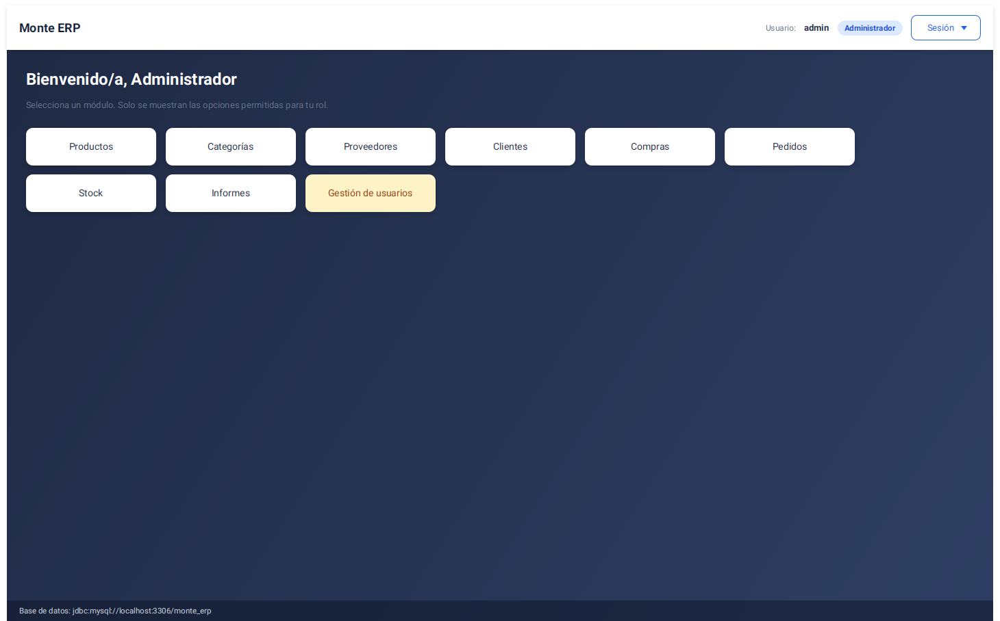

Si has cargado los datos de demostración (`db/seed/demo_seed.sql`), puedes entrar
con:

| Usuario | Contraseña | Rol | Estado |
| --- | --- | --- | --- |
| `admin` | `Admin1234` | Administrador | Activo |
| `ana.garcia` | `Demo1234` | Empleado | Activo |
| `luis.moreno` | `Demo1234` | Empleado | Activo |
| `marta.sanz` | `Demo1234` | Empleado | **Inactivo** |

---

## 2. Puesta en marcha

Antes de abrir la aplicación necesitas:

1. Un servidor **MySQL 8.0** accesible (por ejemplo el contenedor Docker del
   `README` del proyecto).
2. Un **keyring del sistema** donde se guardan el usuario y la contraseña de la
   base de datos (nunca se escriben en disco en claro).

La primera vez que arrancas la aplicación, esta no encuentra configuración y abre
la pantalla de **Configuración inicial** (apartado 4). A partir de ahí, cada
arranque empieza en la pantalla de acceso.

---

## 3. Iniciar y cerrar sesión

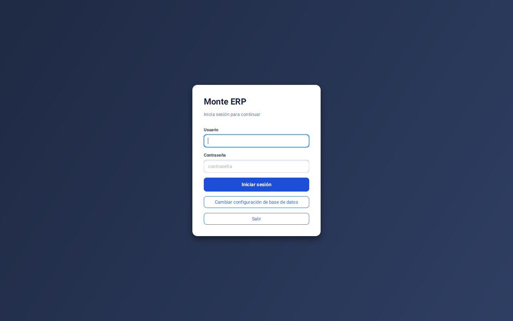

1. Escribe tu **usuario** y tu **contraseña**.
2. Pulsa **Iniciar sesión** (o la tecla **Intro** con el cursor en la contraseña).

Si los datos no son correctos, la contraseña se borra y aparece siempre el mismo
mensaje genérico, tanto si el usuario no existe como si está dado de baja:

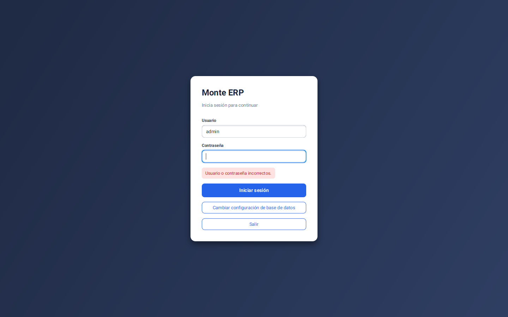

> **No se revela el estado de la cuenta.** Un usuario inactivo recibe el mismo
> mensaje que una contraseña equivocada, para no filtrar qué cuentas existen.

Desde esta pantalla también puedes:

- **Cambiar configuración de base de datos**: abre la pantalla del apartado 4 sin
  la sección del administrador.
- **Salir**: cierra la aplicación.

Ya dentro de la aplicación, el botón **Sesión** de la cabecera abre dos opciones:

- **Cerrar sesión**: vuelve a la pantalla de acceso y limpia la sesión.
- **Salir**: cierra la aplicación.

---

## 4. Configuración de la base de datos

La configuración se guarda en dos sitios: la **URL** en el fichero
`application.properties` y las **credenciales** en el keyring del sistema. En la
versión empaquetada con `jpackage`, el fichero vive en la carpeta de
configuración del usuario (`%APPDATA%\Monte ERP`,
`~/Library/Application Support/Monte ERP` o `$XDG_CONFIG_HOME/monte-erp`), no en
la carpeta de instalación.

### 4.1. Primera ejecución (*onboarding*)

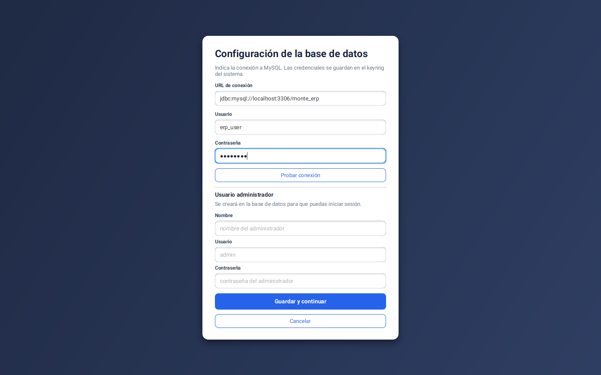

1. Revisa la **URL de conexión** (formato
   `jdbc:mysql://host:puerto/base_de_datos`; no incluyas usuario ni contraseña en
   la URL).
2. Escribe el **usuario** y la **contraseña** de MySQL.
3. Pulsa **Probar conexión**: el resultado aparece justo debajo
   (*Conexión correcta.* o *No se pudo conectar: …*).
4. Rellena la sección **Usuario administrador** (nombre, usuario y contraseña).
5. Pulsa **Guardar y continuar**: la aplicación crea el esquema, aplica las
   migraciones, crea el administrador y te lleva a la pantalla de acceso.

**Cancelar** en este modo cierra la aplicación: sin conexión no hay nada que
hacer.

### 4.2. Cambiar la conexión más adelante

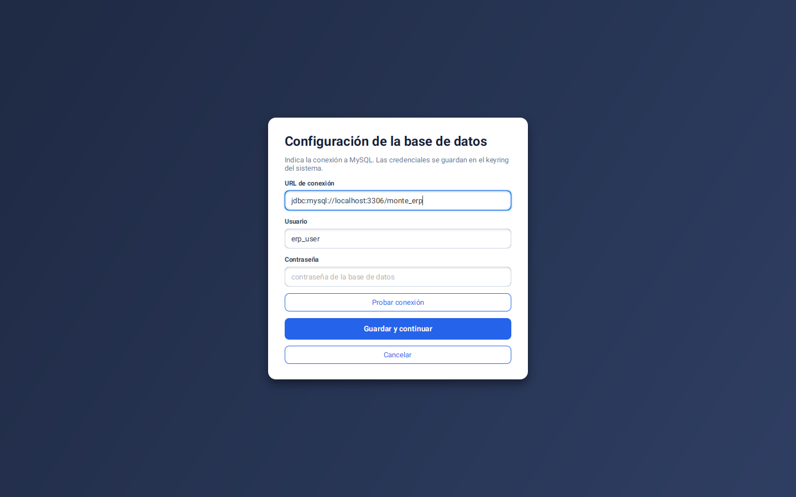

Desde la pantalla de acceso, **Cambiar configuración de base de datos** abre la
misma pantalla sin la sección del administrador. Dos detalles importantes:

- La contraseña guardada **nunca se muestra**: el campo aparece vacío. Si no
  cambias de servidor ni de usuario, basta con pulsar **Probar conexión** o
  **Guardar y continuar**, porque se reutiliza la credencial del keyring.
- Si cambias el **host o el usuario**, hay que volver a escribir la contraseña:
  la credencial guardada solo se reutiliza para el mismo servidor y usuario.

---

## 5. Ventana principal y navegación

En la cabecera ves el usuario y su rol (**Sesión** para cerrar sesión o salir) y,
en el pie, la URL de la base de datos a la que estás conectado.

Cada recuadro abre un módulo:

| Módulo | Para qué sirve |
| --- | --- |
| **Productos** | Catálogo: crear, editar, filtrar y dar de baja productos. |
| **Categorías** | Clasificación de los productos. |
| **Proveedores** | Datos de contacto de los proveedores. |
| **Clientes** | Datos de contacto de los clientes. |
| **Compras** | Registrar entradas de mercancía con sus lotes. |
| **Pedidos** | Pedidos de venta, sus líneas y su estado. |
| **Stock** | Existencias por producto, alertas y detalle de lotes. |
| **Informes** | Informes de stock y ventas, con exportación a CSV y PDF. |
| **Gestión de usuarios** | Cuentas de la aplicación (solo administrador). |

Dentro de cualquier módulo:

- **Volver** (arriba a la derecha) o la tecla **ESC** regresan al menú principal.
- **Actualizar** vuelve a leer los datos de la base de datos.
- Los módulos de catálogo se dividen en dos zonas: la **lista con filtros** a la
  izquierda y el **formulario** a la derecha.

Si entras como empleado, el menú simplemente no muestra la gestión de usuarios; el
resto es idéntico:

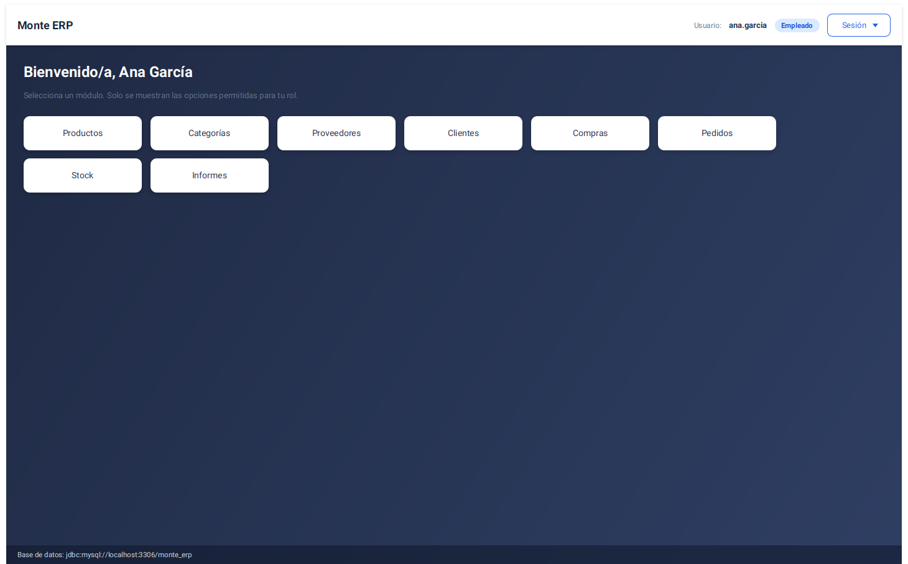

---

## 6. Gestión de usuarios (solo administrador)

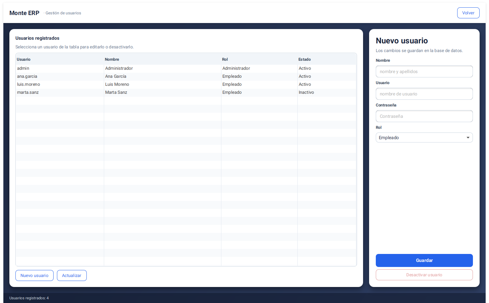

La tabla muestra **todas** las cuentas (activas e inactivas) con su usuario,
nombre, rol y estado. En el pie se cuenta cuántos usuarios hay registrados.

### 6.1. Crear un usuario

1. Pulsa **Nuevo usuario**.
2. Rellena **Nombre**, **Usuario**, **Contraseña** y elige el **Rol**.
3. Pulsa **Guardar**.

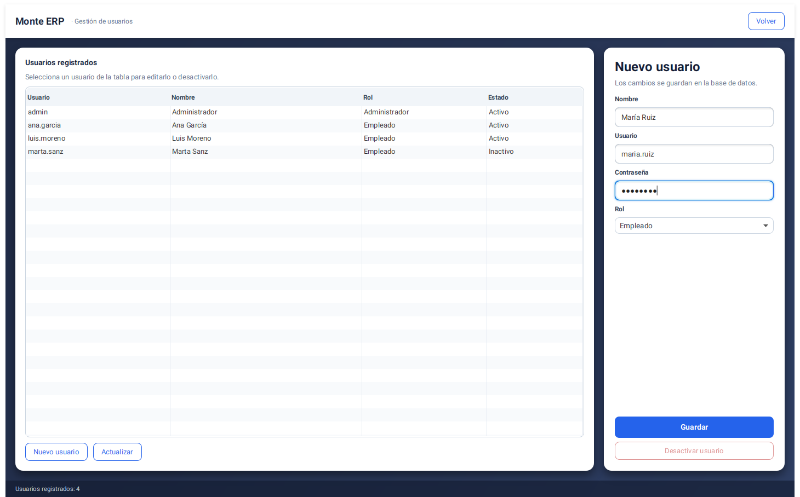

El resultado se confirma con un mensaje en verde y la fila nueva ya aparece en la
tabla:

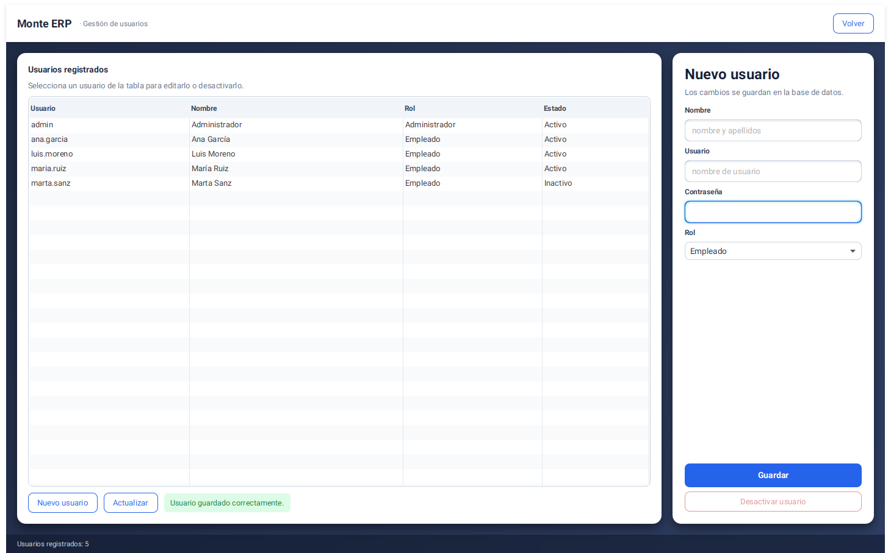

Reglas de validación:

- Los tres campos son obligatorios al crear.
- El **nombre de usuario** es único; si ya existe, se rechaza:

  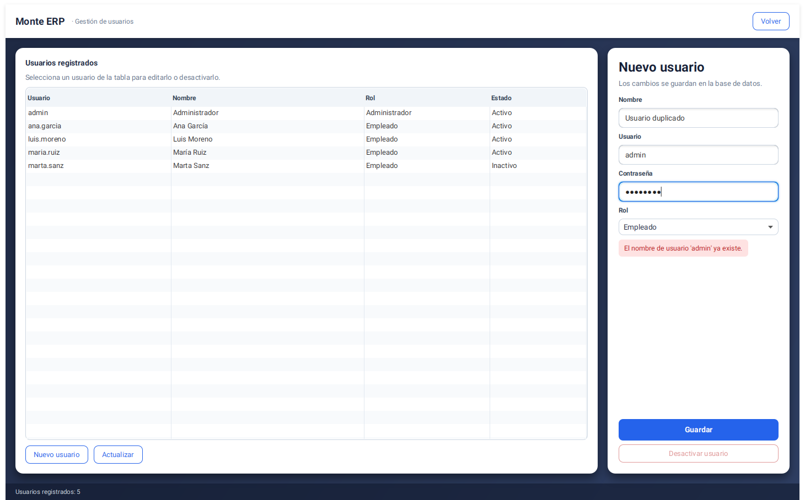

- Al **editar** un usuario, dejar la contraseña en blanco **mantiene la actual**
  (el campo lo indica con el texto de ayuda *Dejar en blanco para mantener la
  actual*).

### 6.2. Editar

Selecciona una fila de la tabla: el formulario pasa a **Editar usuario** con los
datos cargados. Cambia lo que necesites y pulsa **Guardar**.

### 6.3. Dar de baja y reactivar

1. Selecciona el usuario en la tabla.
2. Pulsa **Desactivar usuario** y confirma en el diálogo:

   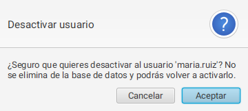

3. La cuenta queda **Inactiva**: no se borra de la base de datos y puede
   reactivarse seleccionándola y pulsando **Activar usuario**.

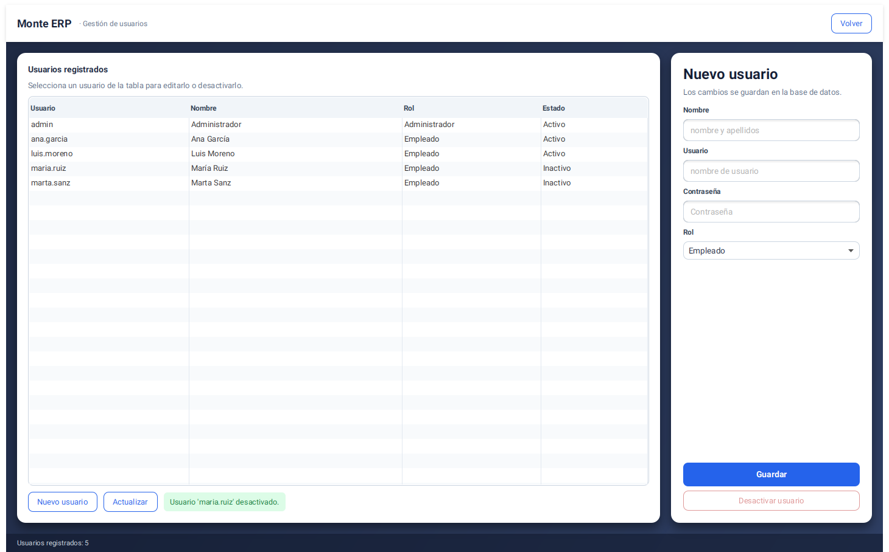

**Protecciones del administrador:** el administrador no puede desactivarse a sí
mismo ni quitarse el rol de administrador.

> **Las bajas son lógicas.** Nunca se borran usuarios, productos, categorías,
> proveedores ni clientes: se marcan como inactivos para no romper el histórico de
> compras y pedidos.

---

## 7. Categorías

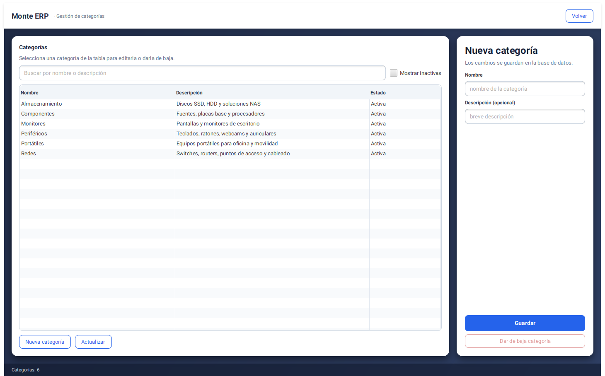

- **Buscar** por nombre o descripción y marcar **Mostrar inactivas** para incluir
  las categorías dadas de baja.
- **Nueva categoría**: nombre obligatorio y descripción opcional.

- **Guardar** confirma el alta. Al seleccionar una fila, el formulario pasa a modo
  edición y el botón de baja se activa (**Dar de baja categoría** /
  **Reactivar categoría**).

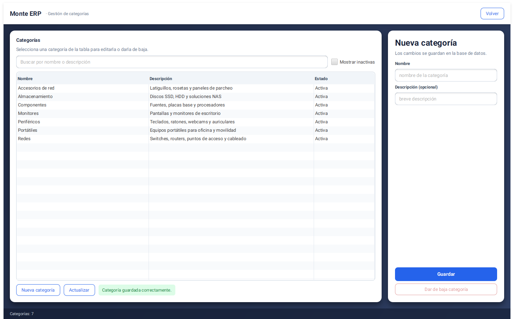

> Un producto **no puede quedarse con una categoría dada de baja**: al guardarlo,
> la aplicación pide elegir otra categoría o dejarlo sin categoría.

---

## 8. Proveedores y clientes

Ambos módulos funcionan igual: lista con búsqueda, formulario a la derecha y baja
lógica.

### 8.1. Proveedores

El buscador filtra por nombre, teléfono o correo. El alta pide **Nombre**
(obligatorio) y permite teléfono, correo y dirección:

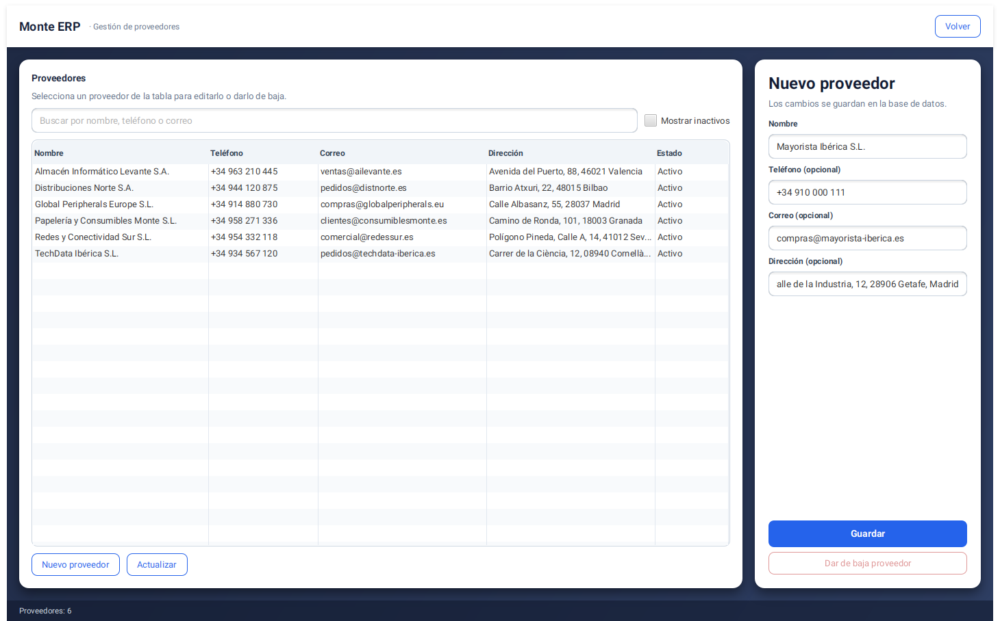

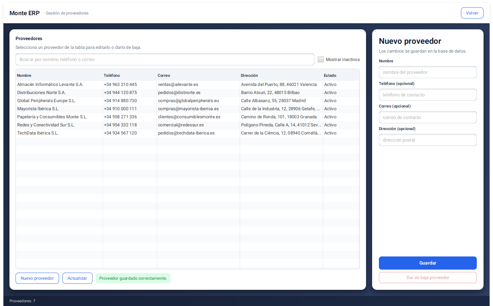

Los proveedores activos son los que aparecen al registrar una **compra**.

### 8.2. Clientes

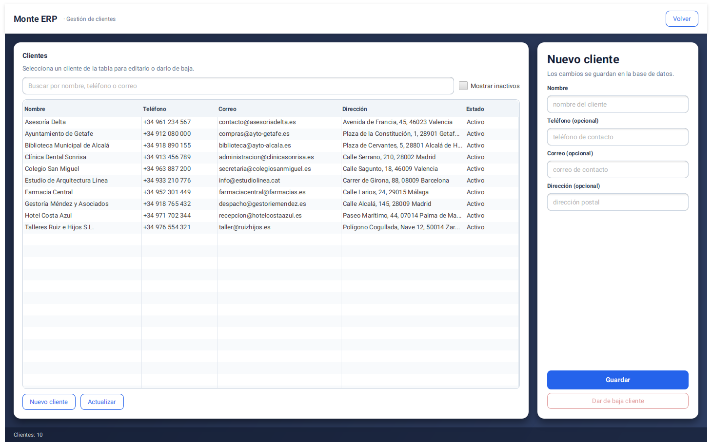

Mismo patrón; los clientes activos son los que aparecen al crear un **pedido**.

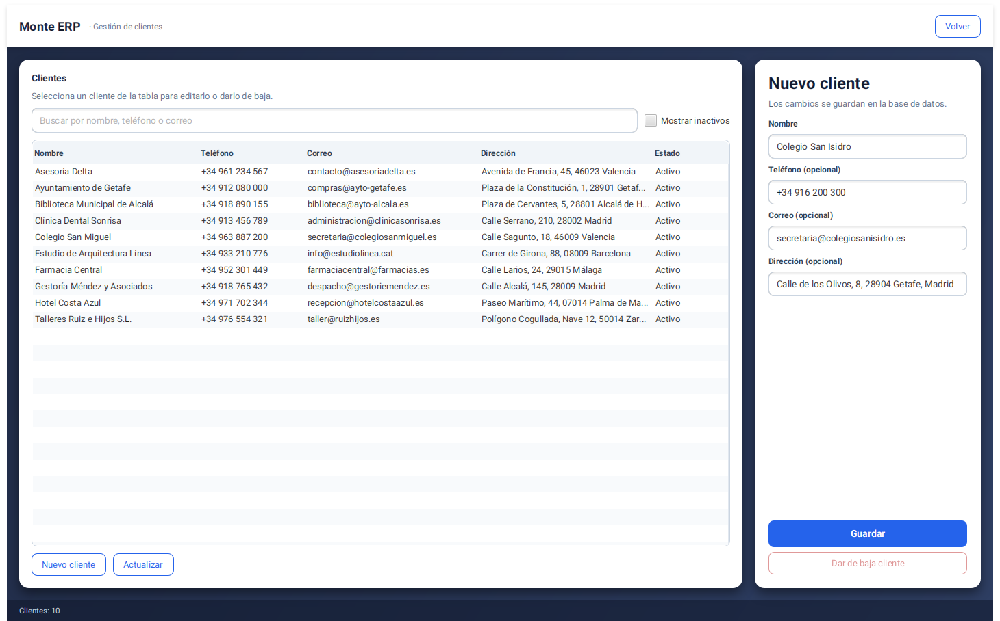

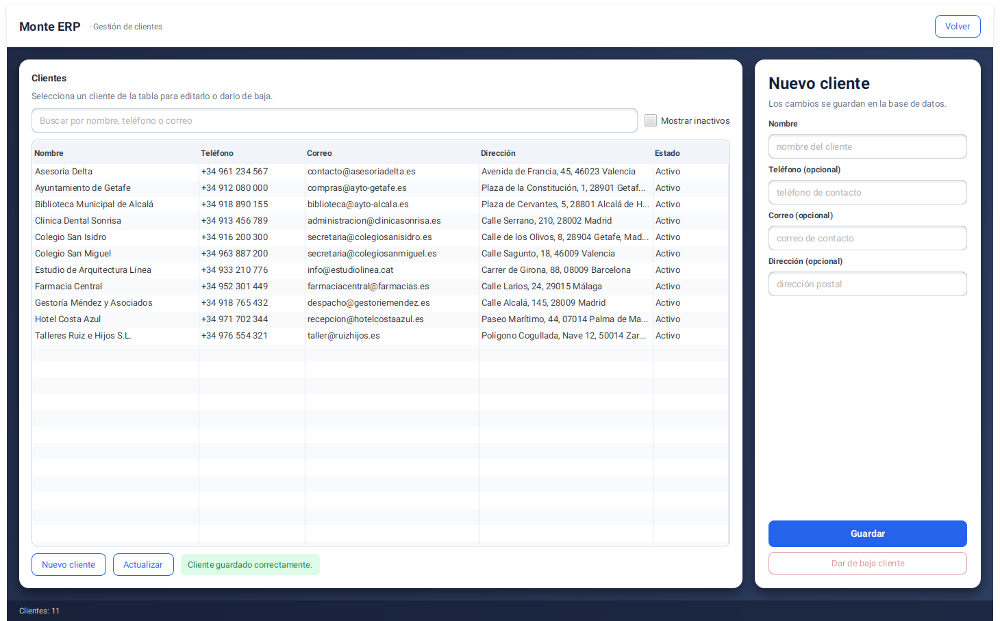

Validaciones comunes:

- **Nombre** obligatorio (longitud máxima limitada).
- **Teléfono** opcional, pero solo admite números y los signos `+ - ( ) .` y
  espacios.
- **Correo** opcional, pero debe tener un formato válido.
- Solo se pueden dar de baja (y reactivar) desde la fila seleccionada.

---

## 9. Productos

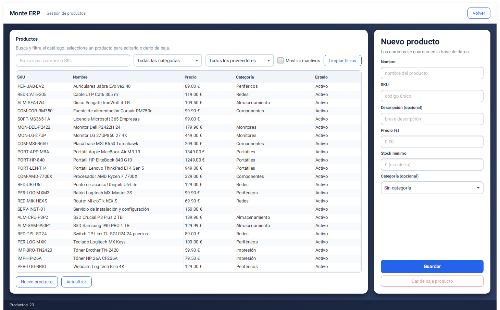

La tabla muestra **SKU, Nombre, Precio, Categoría y Estado**, con el número de
productos en el pie. Filtros disponibles:

- **Buscar por nombre o SKU** (texto libre, sin distinguir mayúsculas ni acentos).
- **Categoría** y **Proveedor**.
- **Mostrar inactivos**: los productos dados de baja solo aparecen si se marca.
- **Limpiar filtros** deja la lista como al entrar.

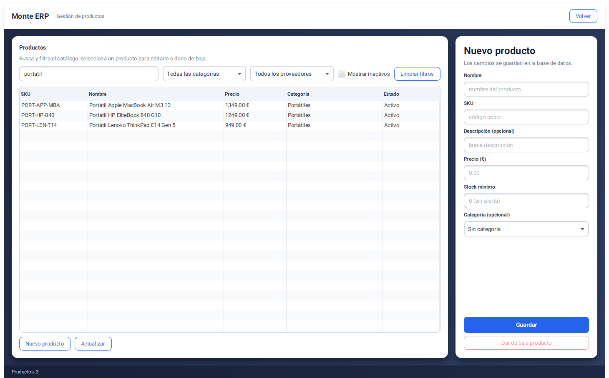

### 9.1. Crear o editar un producto

Pulsa **Nuevo producto** (o selecciona una fila para editar) y rellena:

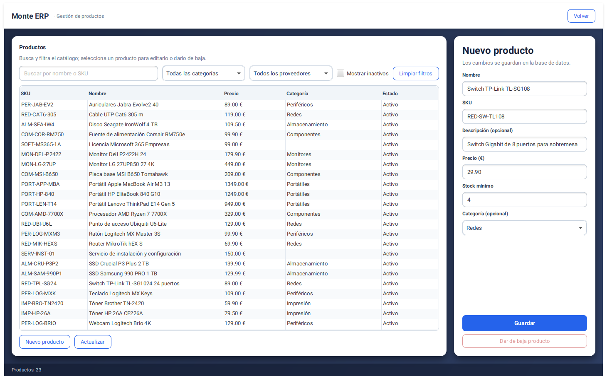

| Campo | Notas |
| --- | --- |
| **Nombre** | Obligatorio. |
| **SKU** | Obligatorio y **único**: *El SKU '…' ya existe.* |
| **Descripción** | Opcional. |
| **Precio (€)** | Obligatorio, no negativo. Solo admite números y el separador decimal. |
| **Stock mínimo** | Entero no negativo. `0` significa “sin alerta”. |
| **Categoría** | Opcional, pero no puede ser una categoría dada de baja. |

Pulsa **Guardar** para confirmar:

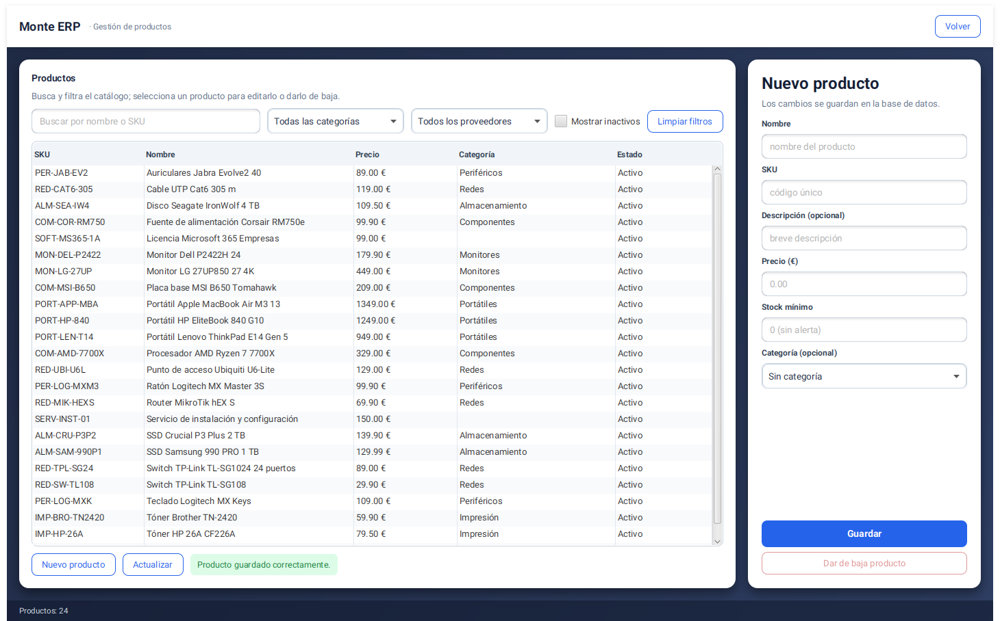

### 9.2. Dar de baja y reactivar

Selecciona el producto y pulsa **Dar de baja producto**, confirmando el diálogo:

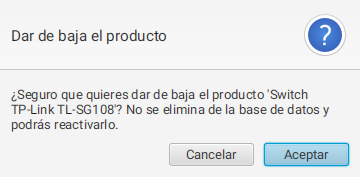

El producto deja de aparecer en la lista (y de ofrecerse en pedidos y compras):

Para recuperarlo, marca **Mostrar inactivos**, selecciónalo y pulsa **Reactivar
producto**.

> **Las máscaras de entrada son estrictas**: el campo de precio descarta letras y
> signos, y el stock mínimo solo acepta enteros. No hace falta corregir nada a
> posteriori: lo que no es válido no llega a escribirse.

---

## 10. Compras y entrada de stock

### 10.1. Histórico y filtros

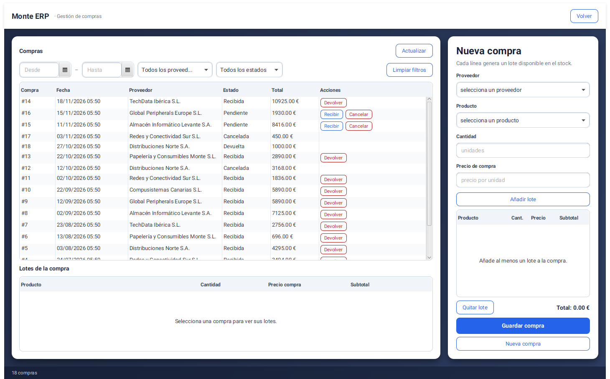

Filtros: rango de fechas (**Desde** / **Hasta**), **proveedor** y **estado**. Un
rango invertido se rechaza con *La fecha «desde» no puede ser posterior a la fecha
«hasta».*

Columnas: **Compra** (número), **Fecha**, **Proveedor**, **Estado**, **Total** y
**Acciones**.

Selecciona una compra para ver sus **lotes** debajo:

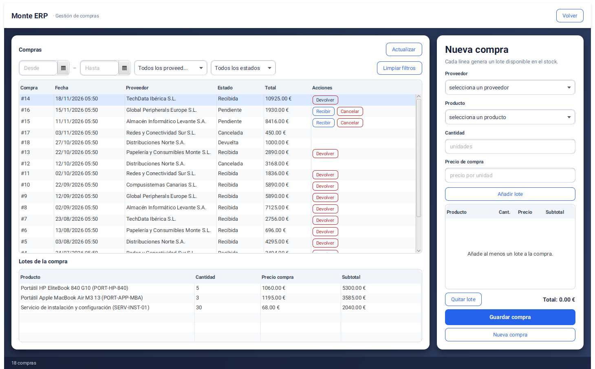

### 10.2. Registrar una compra

1. Pulsa **Nueva compra**.
2. Elige **Proveedor**.
3. Elige **Producto**, **Cantidad** y **Precio de compra**.
4. Pulsa **Añadir lote**: la línea aparece en la tabla del borrador y se acumula el
   **Total**. Un mismo producto no puede repetirse (*El producto ya está en la
   compra.*); usa **Quitar lote** para corregir.
5. Pulsa **Guardar compra**.

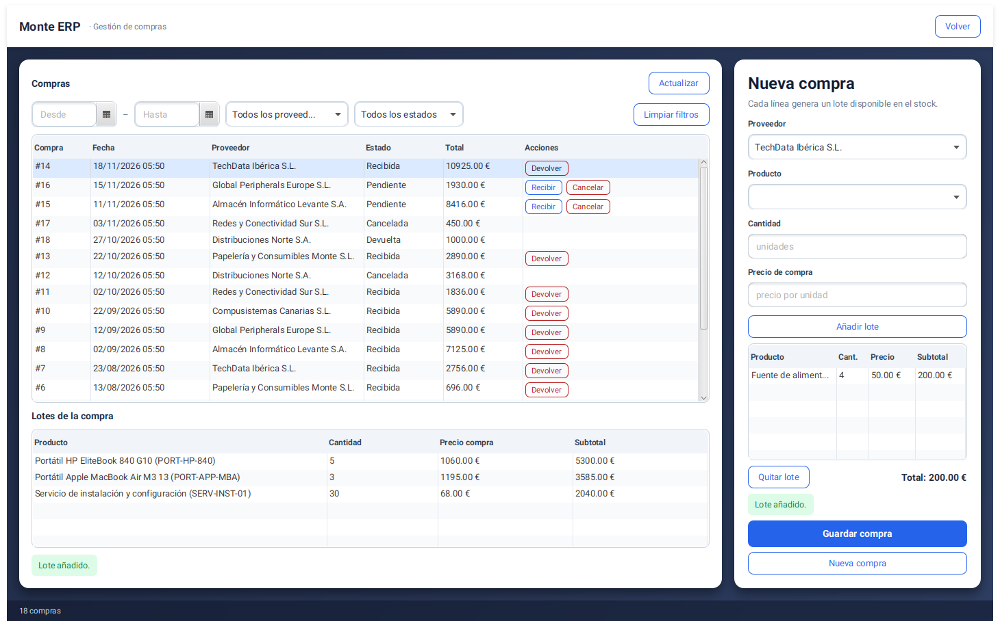

La compra nace en estado **Pendiente**, que ves confirmado en el pie del
formulario y en la tabla:

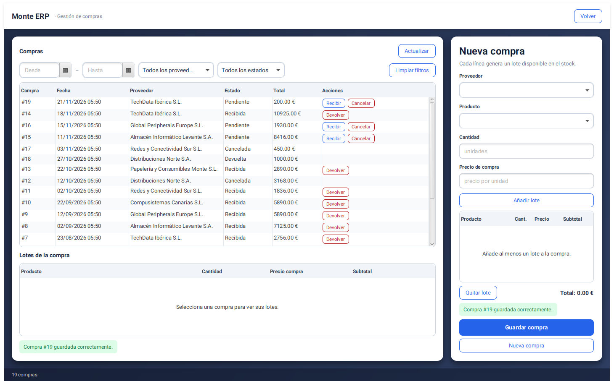

> **Mientras está pendiente, el stock no está disponible.** Los lotes existen para
> trazabilidad, pero no suman existencias hasta recibir la compra.

### 10.3. Ciclo de vida

| Estado | Acciones disponibles | Qué pasa con el stock |
| --- | --- | --- |
| **Pendiente** | **Recibir**, **Cancelar** | Al recibir, los lotes pasan a estar disponibles. Al cancelar, se quedan a cero. |
| **Recibida** | **Devolver** | Al devolver, los lotes se vacían. |
| **Devuelta** / **Cancelada** | — (estado final) | Los lotes se conservan para trazabilidad, marcados en los informes y fuera de los totales. |

Ejemplo de recepción (botón **Recibir** de la fila):

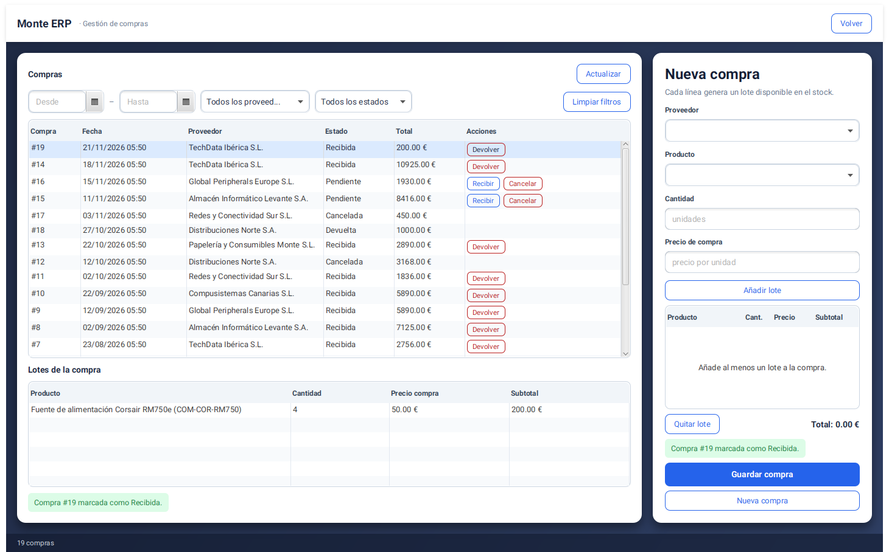

Una compra **no se puede devolver** si parte de su stock ya se ha vendido: el
mensaje indica cuántas unidades faltan (*No se puede devolver la compra #6: … N
unidades ya se han vendido.*).

---

## 11. Pedidos de venta y consumo FIFO

### 11.1. Histórico y filtros

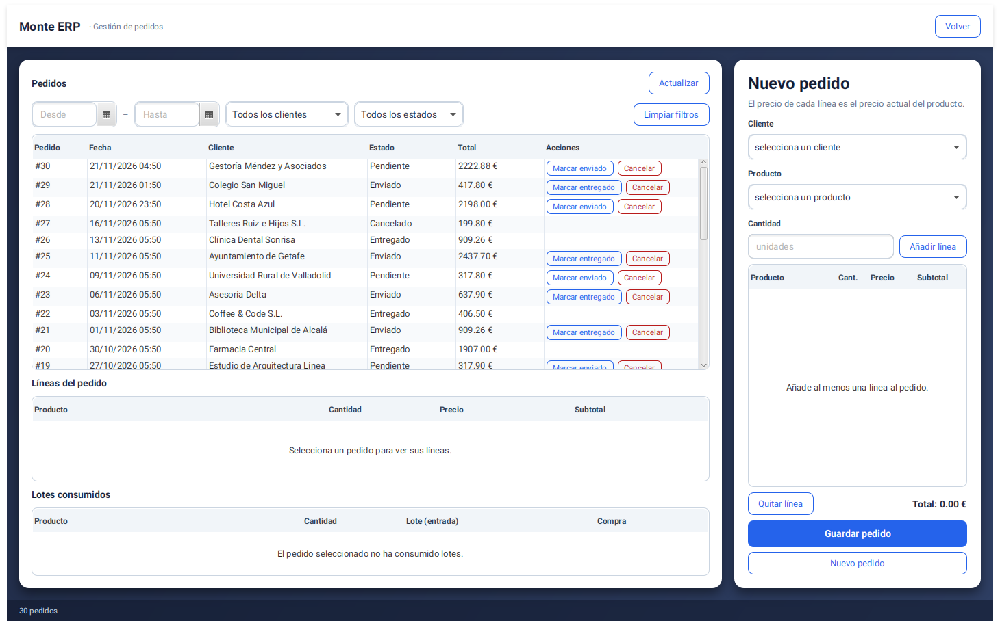

Filtros: rango de fechas, **cliente** y **estado**. Columnas: **Pedido**,
**Fecha**, **Cliente**, **Estado**, **Total** y **Acciones** (los botones de
cambio de estado que permite cada pedido).

### 11.2. Detalle de un pedido

Selecciona una fila para ver, debajo, sus **líneas** y —lo más interesante— los
**lotes consumidos**:

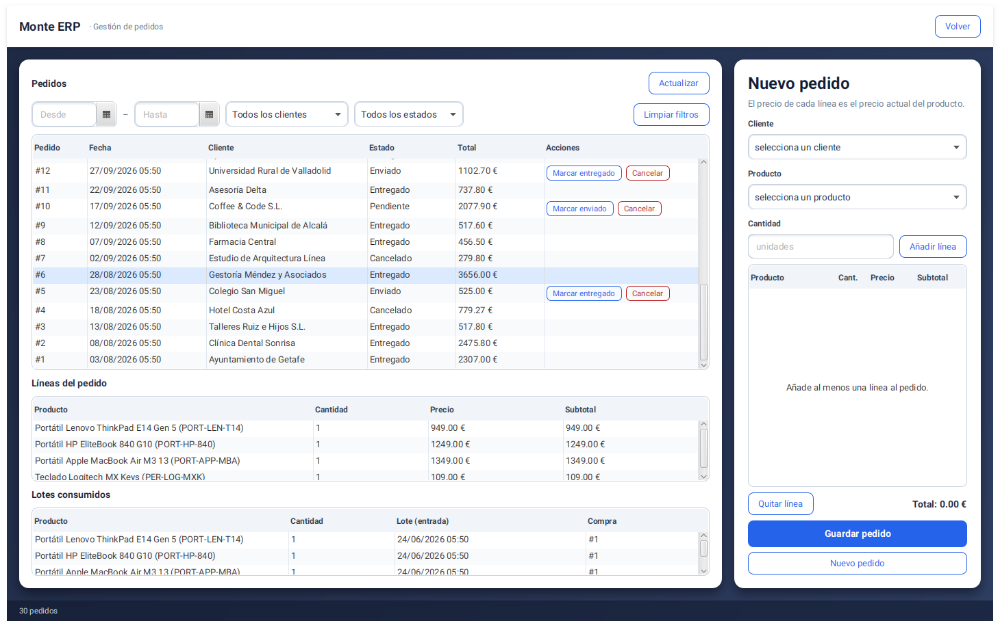

La tabla *Lotes consumidos* muestra de qué **lote** (entrada de compra) salió cada
unidad y en qué **compra** entró la mercancía. Es la trazabilidad completa de la
venta: el consumo es **FIFO** (primero entra, primero sale).

### 11.3. Crear un pedido

1. Pulsa **Nuevo pedido**.
2. Elige **Cliente**.
3. Elige **Producto**: la aplicación muestra *Disponibles: N unidades* y limita la
   cantidad a ese stock.
4. Escribe **Cantidad** y pulsa **Añadir línea**.
5. Repite para cada producto (uno por línea). El **Total** se acumula y cada línea
   se puede quitar con **Quitar línea**.
6. Pulsa **Guardar pedido**.

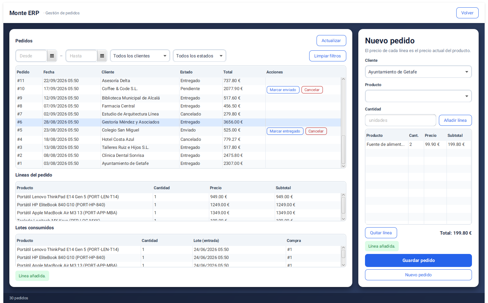

El precio de cada línea es el **precio actual del producto** en el catálogo. Al
guardar, el pedido queda **Pendiente** y el stock se descuenta según FIFO:

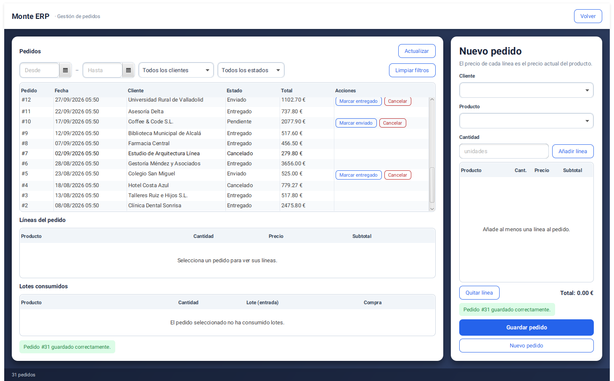

Validaciones frecuentes:

- Hace falta un cliente (*Selecciona un cliente.*) y al menos una línea (*Añade al
  menos una línea al pedido.*).
- Un producto no puede repetirse en el mismo pedido (*El producto ya está en el
  pedido.*).
- La cantidad es un entero mayor que 0 y no puede superar el stock disponible; si
  otro usuario se te adelanta, al guardar verás *Stock insuficiente de «…»: se
  piden N y solo hay M.*

### 11.4. Cambiar el estado

El ciclo es **Pendiente → Enviado → Entregado**, con **Cancelar** disponible
mientras no sea final:

| Estado | Acciones | Efecto |
| --- | --- | --- |
| **Pendiente** | **Marcar enviado**, **Cancelar** | — |
| **Enviado** | **Marcar entregado**, **Cancelar** | — |
| **Entregado** | — | Estado final. |
| **Cancelado** | — | Estado final: **devuelve el stock** consumido por el pedido. |

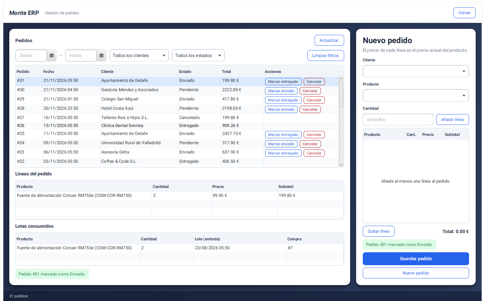

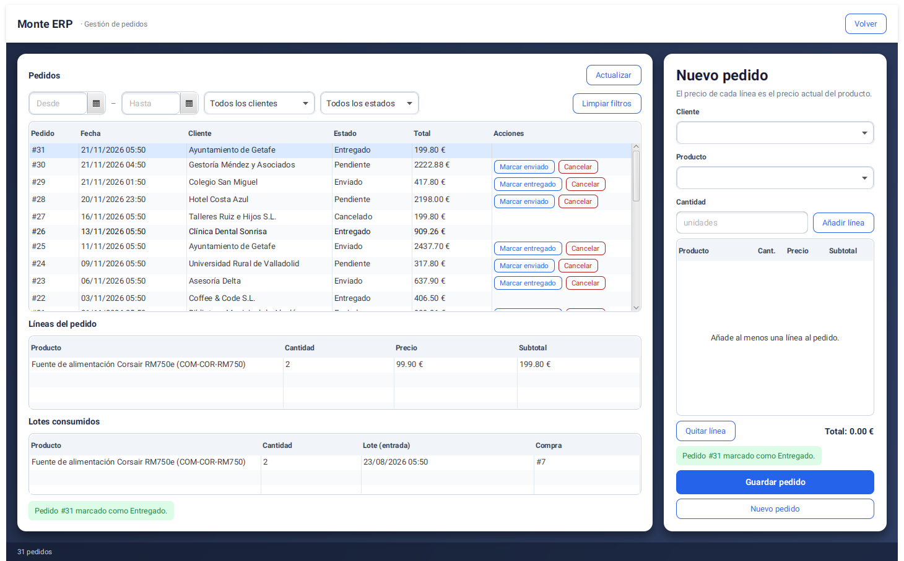

Cancelar pide confirmación (*Cancelar el pedido #N*) y, al aceptar, las unidades
vuelven a sus lotes originales, respetando el orden FIFO.

---

## 12. Control de stock

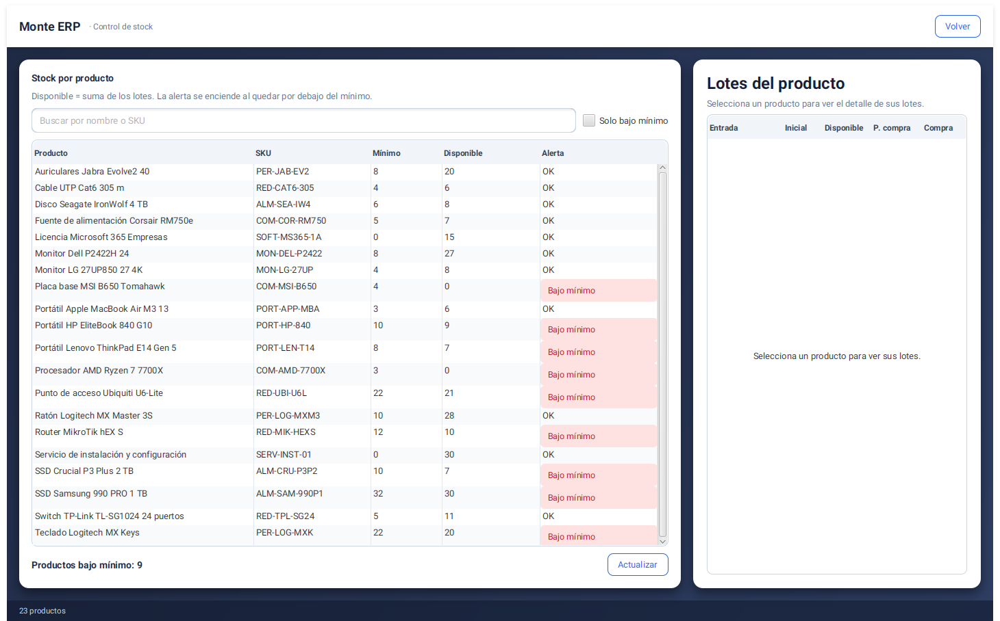

La tabla muestra, por producto activo, **Mínimo**, **Disponible** y **Alerta**. El
disponible es la suma de los lotes; la alerta se enciende cuando queda **por
debajo** del mínimo.

- **Buscar** por nombre o SKU.
- **Solo bajo mínimo** deja únicamente los productos en alerta. El pie resume
  cuántos hay (*Productos bajo mínimo: N*).

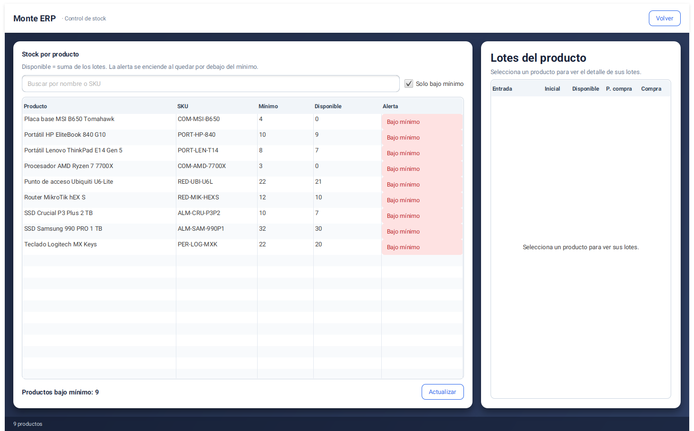

Selecciona un producto para ver el detalle de sus **lotes** (entrada, cantidad
inicial, disponible, precio de compra y compra de la que procede), incluidos los
lotes ya agotados:

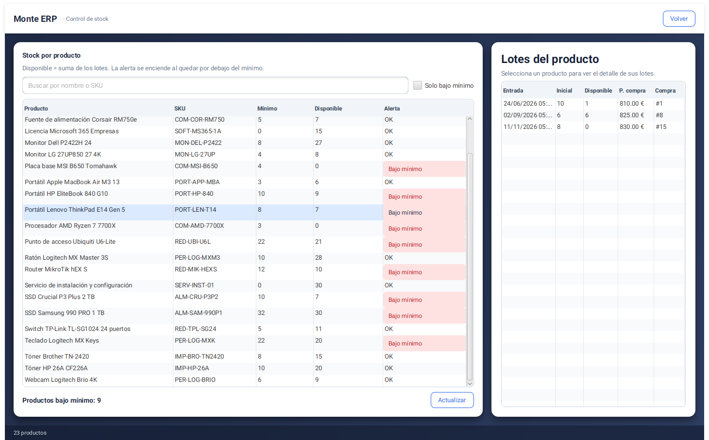

Este módulo es **solo de consulta**: el stock se mueve registrando compras
(entradas) y pedidos (salidas). Para corregir una diferencia, ajusta la compra o el
pedido de origen, no el stock directamente.

---

## 13. Informes y exportación

El **Período** (Desde / Hasta) filtra los dos informes; sin fechas se muestra todo
el histórico. **Generar** aplica el periodo y **Limpiar** lo borra (un rango
invertido se rechaza igual que en el resto de módulos).

### 13.1. Stock por lotes

Cada fila es un **lote** con productos, SKU, fecha de entrada, cantidad inicial,
disponible, precio de compra, compra de origen, estado de la compra y motivo. Los
lotes de compras **devueltas o canceladas** salen en rojo y quedan fuera de los
totales. En el pie se resumen *Lotes*, *Excluidos*, *Unidades disponibles* y
*Valor del stock*.

### 13.2. Ventas por producto

La pestaña **Ventas por producto** agrupa por producto las **unidades vendidas**,
el **importe** y las **unidades canceladas** (en rojo, con su motivo). En el pie:
*Pedidos*, *Pedidos cancelados*, *Unidades vendidas* y *Facturación*.

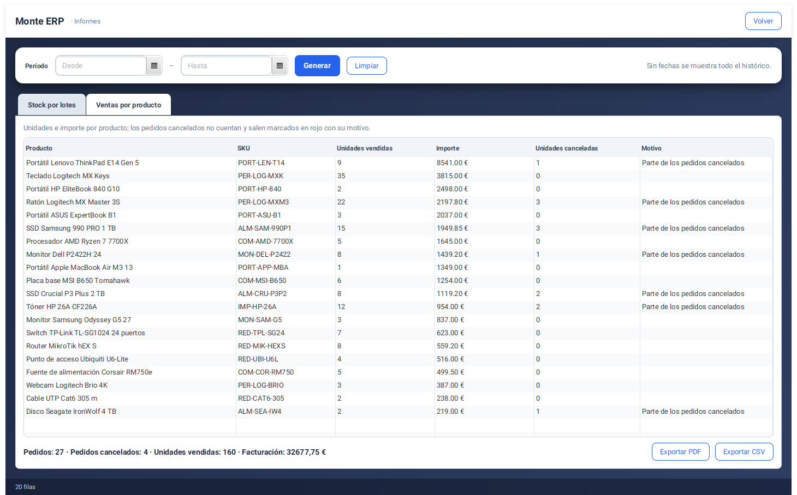

Al filtrar por periodo, ambos informes y sus totales se recalculan:

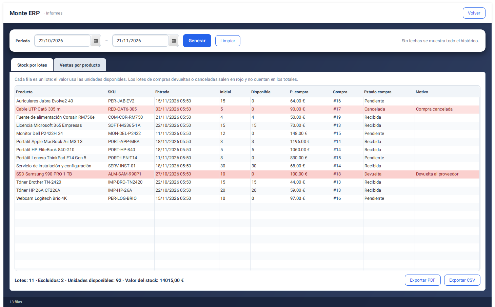

### 13.3. Exportar

Cada pestaña tiene **Exportar CSV** y **Exportar PDF**. Al pulsar uno se abre el
diálogo *Guardar informe* del sistema; al terminar, se confirma con un aviso:

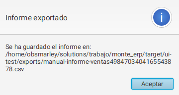

- **CSV**: separado por `;`, con BOM UTF-8 (se abre bien en Excel) y los totales al
  final del fichero.
- **PDF**: listo para imprimir o adjuntar.

Los informes exportados contienen exactamente lo que hay en pantalla en ese
momento, incluido el periodo aplicado.

---

## 14. Mensajes habituales

| Mensaje | Cuándo aparece | Qué hacer |
| --- | --- | --- |
| *Introduce usuario y contraseña.* | Login con campos vacíos. | Rellena ambos campos. |
| *Usuario o contraseña incorrectos.* | Credenciales erróneas **o cuenta inactiva**. | Revisa los datos; si la cuenta está de baja, un administrador debe reactivarla. |
| *La fecha «desde» no puede ser posterior a la fecha «hasta».* | Filtro o periodo invertido. | Corrige el orden de las fechas. |
| *El SKU '…' ya existe.* | Alta/edición de producto con un SKU repetido. | Usa otro SKU. |
| *El nombre de usuario '…' ya existe.* | Alta/edición de usuario duplicado. | Usa otro nombre de usuario. |
| *No puedes quitarte el rol de administrador.* | El administrador se edita a sí mismo. | Mantén el rol de administrador (y la cuenta activa). |
| *El producto ya está en el pedido.* / *… en la compra.* | Línea repetida en el borrador. | Usa **Quitar línea** / **Quitar lote**, o cambia la cantidad en la línea existente. |
| *Stock insuficiente de «…»: se piden N y solo hay M.* | El stock cambió mientras preparabas el pedido. | Reduce la cantidad o actualiza la lista. |
| *El pedido ha cambiado desde que se cargó; se ha actualizado el histórico.* | Otro usuario modificó el pedido. | Revisa el estado actual y repite la acción. |
| *No se puede devolver la compra #N: … unidades ya se han vendido.* | Devolución de una compra consumida. | No se puede devolver: el stock ya salió por pedidos. |
| *No se pudo conectar: …* | Prueba de conexión fallida. | Revisa URL, usuario, contraseña y que MySQL escuche. |
| *Selecciona un … de la tabla.* | Acción sin fila seleccionada. | Selecciona primero la fila. |

---
